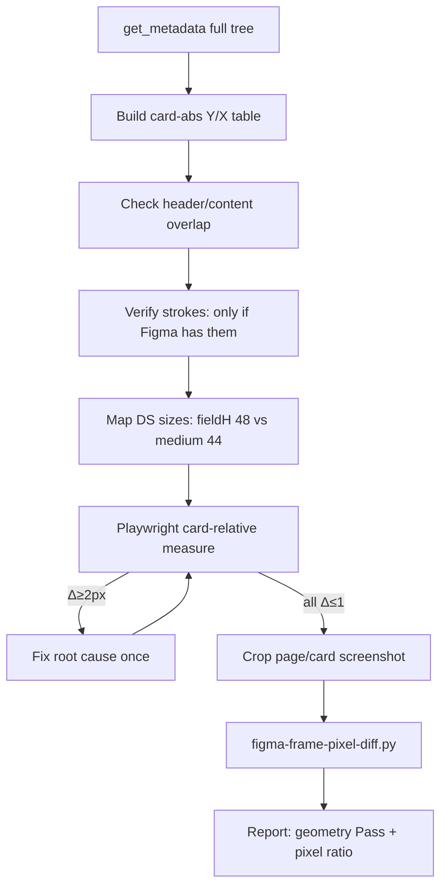

# Figma Parity Fast Path

Learned from a successful review-form parity loop (card 1132×710, fields 48×536, form `pt` 16 not 20).  
**Geometry gate before Diffchecker.** Do not loop screenshots until abs Y tables pass.

Chain: **`figma-card-relative-geometry`** → **`figma-implicit-spacing`** → **`playwright-figma-ui-diff`** → **`playwright-verify-fix-loop`**.

## Order of operations (do not skip)



## Mandatory metadata checklist (before any `sx`)

From `get_metadata` on the **card/modal** (not only the page frame):

| Item                     | How                                                                | Typical fail                                           |
| ------------------------ | ------------------------------------------------------------------ | ------------------------------------------------------ |
| Header h + Content.y     | If `content.y < header.bottom`, overlap                            | `pt:20` under h=72 → fields at 92 not 88               |
| First field abs Y        | `content.y + row0.y`                                               | Wrong form top pad                                     |
| Field w×h                | Instance size (often **536×48**)                                   | DS medium ~44 → cumulative drift                       |
| Row gap                  | `row[i+1].y − row[i].y − fieldH`                                   | Guessed spacing                                        |
| Notes / last block abs Y | Same formula                                                       | Follows field drift                                    |
| Footer y / h             | Card abs                                                           | Buttons look “low”                                     |
| Actions x,y,gap,minWidth | Footer child                                                       | Gap 8 vs 16                                            |
| **Strokes / dividers**   | Line nodes + `get_design_context` stroke/border props + screenshot | Inventing a footer `borderTop` when Figma has **none** |

### Strokes / dividers (do not invent)

1. Open **header and footer** child nodes when the user linked only the page — to **confirm** presence **or absence** of strokes.
2. **Absence is a spec.** If metadata has no Line node, design-context has no `border-t`/`border-b`, and the accurate section screenshot shows no hairline → **do not add** `borderTop`/`borderBottom` or `<Divider />`.
3. **Header ≠ footer.** A header `border-b` does **not** imply a footer `border-t`. Check each section independently (scan-business-review: header has bottom stroke; footer has **no** top stroke).
4. MCP omitting a border in generated code often means **there is no border** — do not “fix” by inventing one. Only add a stroke when Figma evidence shows it (stroke props, Line layer, or unambiguous screenshot).
5. When a stroke **is** present: prefer section `borderTop`/`borderBottom` + `iceGray[200]` over a lone MUI `<Divider />` in flex layouts.
6. Playwright: assert `borderTopWidth === 0` (or unset) on footer when Figma has no top stroke; assert non-zero only when Figma has one.
7. **Heatmap / colored cells:** abutting heat fills create **visual seams that are not strokes**. Before adding a full cell grid, scan the **white header band** (no heat) for continuous vertical rails. MI Report (`15723:428376`) = Pupils right + Total left only.
8. **Diffchecker vertical shift:** portal chrome vs Figma Main-only crops often show a large fake offset. Gate on **page-relative** abs Y from `get_metadata` (Report: table @ **196**) before adding padding.
9. **ICE theme spacing unit is 4px** (`0.25rem`), not MUI’s default 8. Figma gap 24 → Grid `spacing={6}` — `spacing={3}` is only **12px**. Always measure card-edge Δx after changing Grid spacing.

## Card-relative measure snippet (copy)

```js
const card = document.querySelector('[data-test="…-card"]').getBoundingClientRect();
const rel = (el) => {
  const r = el.getBoundingClientRect();
  return {
    y: Math.round(r.top - card.top),
    x: Math.round(r.left - card.left),
    w: Math.round(r.width),
    h: Math.round(r.height),
  };
};
// Fail if field[0].y !== figmaFirstFieldAbsY (±1)
```

## DS size lock (zone-local OK)

When Figma `input-outlined` is **48** and DS `medium` paints **~44**:

```ts
'& .MuiOutlinedInput-root:not(.MuiInputBase-multiline)': {
  height: 48,
  minHeight: 48,
  boxSizing: 'border-box',
},
```

Do **not** change DS defaults without `shared-component-guard` + user approval.

## Diffchecker / pixels (after geometry Pass)

1. Compare **frame crops only** (`[data-test="…-page"]` or card) — never full portal chrome.
2. `python3 apps/e2e/agent-browser/scripts/figma-frame-pixel-diff.py …` (default fail-ratio 2%).
3. `--shift-y N` to confirm a constant offset theory (if shifting _increases_ error, you already fixed it).
4. Remaining magenta from sample text / CoreText vs Skia is **advisory** after geometry Pass.

## Speed tips (research-backed)

- Abs Y tables beat overlay eyeballing for root cause ([figma-overlay-check](https://github.com/dengshangli/figma-overlay-check), design-verify).
- Mask text / ignore-text for residual ratio ([figma-pixel-kit](https://github.com/ozanzeng/figma-pixel-kit)).
- Same DSF for Figma export and app capture (prefer **1** for agent).
- Fix **one** root cause per round (top offset OR field height OR gap) — not three margins.

## Pass criteria

- Card-relative table: every listed abs Y/X/W/H Δ ≤ 1px (Fail ≥ 2px)
- **Chrome gates** (when frame has them): header→card gap, sidebar list top inset, primary/split-button `nowrap` + single line — see `playwright-figma-ui-diff` §3b. Card tables alone missed Account Settings (+16 header gap, +16 nav inset, wrapped "Change Image")
- Strokes match Figma **presence and absence** (no invented footer divider)
- Frame pixel `diffRatio` ≤ ~2% **or** residual explained as content/AA only
- PNGs shown: `figma-baseline`, `app-frame`, `diff`

## Mistakes this skill prevents

- Diffchecker with sidebars → fake global ghost
- `headerH + content.pt` when Content overlaps header
- Leaving DS medium 44 against Figma 48
- **Inventing footer `borderTop` / `<Divider />` because the header has a bottom stroke**
- Treating “MCP omitted border” as “must add border”
- > 3 rounds of random `mt` without an abs Y table
