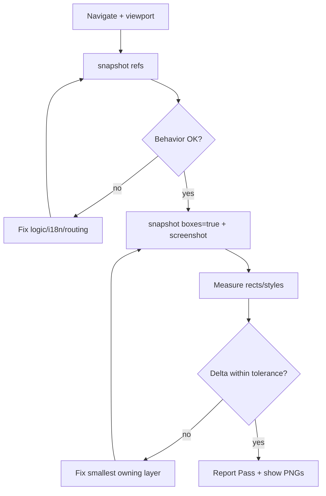

# Playwright Verify-Fix Loop

Orchestrates **test → measure → compare → fix → re-verify**.  
Companion: **`playwright-agent-eyes`** · **`figma-implicit-spacing`** · **`figma-pixel-parity-check`** · **`eslint-and-verification`**.

## When

- User asks to test a page/component in the browser and fix issues
- After Figma implementation — runtime proof before sign-off
- Bug report (“spacing wrong”, “button missing”, layout overflow)
- Before promoting a flow to `apps/e2e/agent-browser/tests/flows/`

## Prerequisites

1. Portal: `pnpm nx serve portal` → `http://localhost:4200/portal/`
2. MCP: **`project-0-ice-web-app-playwright`** (or `playwright`) + optional **`chrome-devtools`**
3. Viewport: **1530×920**, `deviceScaleFactor: 1` (match Figma frame when different)
4. Auth: click `[data-test="login-btn"]` or use `PLAYWRIGHT_STORAGE_STATE`
5. Fallback if MCP down: `pnpm e2e:agent:eyes-smoke` + Read PNGs from `temp/agent-browser/`

## Skill chain (Figma + UI)

```
figma-design-system-parity
  → figma-implicit-spacing      (derive gaps MCP missed)
  → figma-pixel-parity-check    (spec tables)
  → playwright-verify-fix-loop  (this skill — runtime gate)
  → eslint-and-verification     (after code edits)
```

Page shells / fixed cards: also **`figma-page-shell-layout`**.

## The loop (max 3 fix rounds unless user asks for more)



### Step 1 — Navigate & authenticate

```text
browser_navigate → full URL under /portal/...
browser_resize 1530×920 if needed
Login: snapshot → click login ref ([data-test="login-btn"])
```

Use **`localhost`**, not `127.0.0.1`, when Vite binds IPv6.

### Step 2 — Behavior snapshot (interaction)

- `browser_snapshot` — use **refs** only; re-snapshot after each action
- Assert roles/text from i18n (English dev locale)
- `browser_verify_text_visible` / `browser_verify_element_visible` when available

### Step 3 — Layout & pixel evidence

- `browser_snapshot` with **`boxes: true`** — `[box=x,y,w,h]` per node
- `browser_take_screenshot` — `scale: "css"`, save under `temp/agent-browser/{slug}-1530x920.png`
- **Read PNG into chat** so the user sees the same frame
- Optional: `browser_evaluate` / `browser_run_code`:

```js
(el) => {
  const r = el.getBoundingClientRect();
  const s = getComputedStyle(el);
  return {
    x: r.x,
    y: r.y,
    w: r.width,
    h: r.height,
    gap: s.gap,
    paddingTop: s.paddingTop,
    marginTop: s.marginTop,
    fontSize: s.fontSize,
    fontWeight: s.fontWeight,
  };
};
```

### Step 4 — Compare

Build a table:

| Check | Expected (Figma/metadata) | Measured (Playwright) | Δ   | Severity |
| ----- | ------------------------- | --------------------- | --- | -------- |

**Severity:**

- **Fail:** ≥4px layout, wrong component, missing control, overflow clipping padding, cumulative row drift from wrong field height, edge CTA inset ≫ page padding on a taller viewport
- **Warn:** 2–3px subpixel, font rendering, sample content mismatch
- **Pass:** ≤2px or documented token drift

For spacing expected values, prefer **`figma-implicit-spacing`** coordinate math over MCP `gap`.

### Step 4b — Responsive ownership (single desktop Figma)

Load **`figma-responsive-ownership`** for the full matrix. Summary:

Figma/agent **1530×920** is the parity size. Responsive is still **on us** when no mobile frames exist:

1. After desktop Pass, run phone (**375×667**), tablet (**768×1024**), and **oversized** (**1920×1200**) — not only oversized
2. For controls with Figma `rightInset`/`bottomInset` ≈ page padding (often 24): assert measured content-edge insets stay ~24 (≤2px) on oversized
3. Do **not** expect the Figma card→button Y gap to stay constant — leftover space grows; the **edge pin** is the invariant
4. Assert no horizontal scroll / eaten side padding on phone; cards stay fluid (`minWidth: 0`)
5. Screenshot `{slug}-375.png`, `{slug}-768.png`, `{slug}-oversized.png` under `temp/agent-browser/`
6. Re-verify **1530×920** after responsive fixes

When the user expects Diffchecker-level results, also run **`playwright-figma-ui-diff`**: crop to Figma frame, evidence table including **field height** (watch cumulative 44 vs 48 drift), then `figma-frame-pixel-diff.py`.

### Step 5 — Fix (smallest owning layer)

1. Zone/feature component `sx` / layout
2. Shared composite only with **`shared-component-guard`** approval
3. DS token / variant — not raw hex or fontSize in features
4. i18n keys — not hardcoded strings

Do **not** patch tests to hide UI bugs.

### Step 6 — Re-verify

Repeat steps 2–5 until **Pass** or blocked (auth, API, missing Figma node).

Then: `pnpm nx run <project>:lint` + `:type-check` on touched project (`eslint-and-verification`).

### Step 7 — Report

```markdown
## Playwright verify — [route]

**Viewport:** 1530×920 DSF 1  
**Result:** Pass | Partial | Fail

### Screenshots

- temp/agent-browser/...

### Measurements

| ... |

### Fixes applied

- `path/to/file.tsx` — ...

### Remaining / blocked

- ...
```

## Console & network

Use **Chrome DevTools MCP** when:

- Page stuck loading / white screen
- API 4xx/5xx on feature endpoints
- Lighthouse/a11y audit explicitly requested

## Promote to durable test?

Only when flow is stable **and** user asked → `apps/e2e/agent-browser/tests/flows/`.  
Use `data-test` attribute; `baseURL` ends with `/portal/`; paths without leading `/`.

## Mistakes

- Screenshot-only pass without box measurement for spacing claims
- Trusting MCP `gap` without metadata cross-check
- Fixing parent portal padding instead of page `setContentPadding(0)` + Figma inset
- Diffchecker **full portal chrome** vs Figma **content frame** (fake global ghosting)
- Ignoring DS field height ≠ Figma input height (cumulative row shift)
- > 3 fix rounds without stating root cause
- Not showing PNGs to the user when visual was the question
- Mass-adding E2E specs without approval

## Commands

```bash
pnpm e2e:agent:eyes-smoke          # MCP fallback + PNGs
PLAYWRIGHT_SKIP_WEBSERVER=1 pnpm e2e:agent:smoke
python3 apps/e2e/agent-browser/scripts/figma-frame-pixel-diff.py --help
pnpm nx run collaborationZone:lint
pnpm nx run collaborationZone:type-check
```

Docs: `docs/agent-browser.md` · `docs/figma-ui-verification.md`
